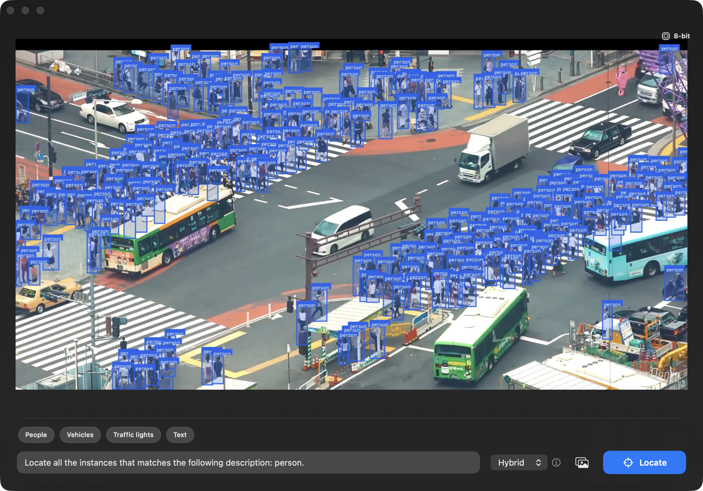

# mlx-swift-LocateAnything

A Swift/[MLX](https://github.com/ml-explore/mlx-swift) port of **[LocateAnything-3B](https://huggingface.co/nvidia/LocateAnything-3B)** — NVIDIA's fast, high-quality vision-language *grounding* model — for on-device inference on Apple Silicon.

📖 [API documentation](https://mnmly.github.io/mlx-swift-LocateAnything/)

Given an image and a natural-language instruction, LocateAnything returns bounding boxes (or points) for the described objects: multi-object detection, referring-expression grounding, GUI-element grounding, text localization, and pointing.



<sub>The bundled SwiftUI demo grounding "person" across a crowded intersection (8-bit, hybrid PBD).</sub>

> Status: the full model graph (MoonViT vision + Qwen2 decoder + connector), standard autoregressive decoding, **and Parallel Box Decoding (PBD)** — the paper's atomic single-step box decoder — are all ported and verified against the Python `mlx-vlm` reference (per-stage tensor parity + per-box parity to ±1/1000 on confident boxes).

## Architecture

```
image ─► MoonViT vision tower (Kimi-VL lineage, 2D axial RoPE, bicubic pos-emb)
      ─► LN + Linear + GELU + Linear connector (2×2 patch merge → 4608 → 2048)
      ─► scatter into text embeddings at <IMG_CONTEXT> (InternVL-style)
      ─► Qwen2 decoder (36 layers, GQA 16/2, tied embeddings, RoPE θ=1e6)
      ─► box grammar: <ref>label</ref><box><x1><y1><x2><y2></box>
```

Coordinate tokens `<0>…<1000>` (ids 151677–152677) encode normalized `0–1000` coordinates.

## Install

Requires macOS 14+ and Xcode. Add as a SwiftPM dependency, or build the CLI:

```bash
git clone <this repo> && cd mlx-swift-LocateAnything
swift build -c release
```

The 8-bit weights (`mlx-community/LocateAnything-3B-8bit`) download automatically on first run. That repo ships a legacy tokenizer (`vocab.json` + `merges.txt`) without a consolidated `tokenizer.json`; the loader **synthesizes one natively in Swift** on first load (no Python required).

## Usage (CLI)

```bash
# Object detection (classes joined with </c>)
locateanything-cli predict image.jpg \
  --prompt "Locate all the instances that matches the following description: person</c>car."

# Referring-expression grounding
locateanything-cli predict image.jpg \
  --prompt "Locate a single instance that matches the following description: the traffic light."

# Point at something
locateanything-cli predict image.jpg \
  --prompt "Point to the search button." --max-tokens 64

# Decoding mode: hybrid (default, PBD + AR fallback) | fast (pure PBD) | slow | ar
locateanything-cli predict image.jpg --mode hybrid

# Use a local snapshot instead of downloading
locateanything-cli predict image.jpg --model-path /path/to/LocateAnything-3B-8bit
```

**Parallel Box Decoding** (`--mode hybrid`, the default) predicts each box/point atomically in one forward pass via a MAGI block-attention mask + masked "future" slots + speculative KV-cache trim, dropping to autoregressive decoding for referring text and malformed boxes. `--mode ar` is the plain token-by-token baseline.

Output is the raw box grammar plus parsed boxes in both normalized (0–1) and pixel coordinates.

## Demo app (SwiftUI)

`Examples/LocateAnythingDemo/LocateAnythingDemo.xcodeproj` is a macOS app that
drives the **same** `LocateAnythingSession` the CLI uses (swift-cli-gui-shared-driver
— the two can't drift). It mirrors the [NVIDIA HF Space](https://huggingface.co/spaces/nvidia/LocateAnything):
pick a **task** (Detection · Grounding · OCR · GUI · Pointing · Custom), type a
description, choose a decoding mode, and boxes/points animate in over the image
(colored per label, with a raw-output view and tok/s stats). A **precision picker**
downloads the 4-bit / 8-bit / bf16 weights into `~/.cache/huggingface` (a cached
copy auto-loads on launch), and a model badge lets you switch variants.

```bash
xcodebuild -project Examples/LocateAnythingDemo/LocateAnythingDemo.xcodeproj \
  -scheme LocateAnythingDemo -destination 'platform=macOS' build
```

## Usage (library)

```swift
import MLXLocateAnything

let session = try await LocateAnythingSession.fromPretrained()   // downloads + loads
let image = try LocateAnythingImageProcessor.loadCGImage(path: "image.jpg")
let result = try session.predict(
    image: image,
    question: "Locate all the instances that matches the following description: car.")

for box in result.boxes {
    print(box.label ?? "?", box.boxPixels)   // pixel [x1,y1,x2,y2]
}
```

## Documentation

Reference docs are published at
**<https://mnmly.github.io/mlx-swift-LocateAnything/>**. DocC (landing page +
curated topics) builds from `Sources/MLXLocateAnything/Documentation.docc`:

```bash
BUILD_DOC=1 Scripts/build_docs.sh            # static site into ./docs
BUILD_DOC=1 Scripts/build_docs.sh preview    # live-reload preview
```

## Numerical parity

Verified per-stage against the Python `mlx-vlm` reference by feeding identical inputs (bisection methodology):

| stage | metric |
|---|---|
| 2D vision RoPE | **exact** (0.0) |
| pos-emb bicubic interpolation | exact kernel port (matches the reference Metal kernel) |
| vision tower output | 0.55 % rel-err (bf16 weights) |
| connector | ~3e-6 rel-err (exact) |
| decoder, per-layer hidden | monotonic 0.004 % → 0.15 % (8-bit quant rounding) |
| argmax / greedy token sequence | **matches Python token-for-token** |

Reproduce (needs the Python reference to dump fixtures, then):

```bash
locateanything-cli parity la_fixtures.safetensors --model-path <snapshot-dir>
```

The 8-bit language model shows a large *last-position logit* rel-err vs the reference, while every argmax and the full greedy sequence match — an artifact of quantized-matmul rounding differences (mlx 0.31 vs 0.32) amplified by the 152k-wide tied output projection, not a correctness bug.

## Benchmark & memory

```bash
locateanything-cli bench image.jpg --runs 6
```

Reuses one loaded model across runs and watches `MLX.Memory.activeMemory` (flat across runs ⇒ no leak; the multi-GB peak is MLX's reusable buffer cache).

## Roadmap

- [x] **Parallel Box Decoding** (MAGI block mask + MTP window + speculative KV-cache trim + top-k threshold sampling).
- [x] **SwiftUI demo app** (`Examples/LocateAnythingDemo`).
- [ ] Optimize PBD sampling (batch the per-block full-vocab `.item()` reads / argsort) so the forward-pass reduction shows up as wall-clock speedup on dense scenes.
- [ ] Exact PIL-bicubic preprocessing parity (currently CoreGraphics — the remaining source of end-to-end box divergence on cluttered scenes).

## License & attribution

The **Swift source code** in this repository is [MIT](LICENSE)-licensed.

The **model** — [NVIDIA LocateAnything](https://research.nvidia.com/labs/lpr/locate-anything/)
(Eagle) — is not distributed here; weights are downloaded at runtime from
[`mlx-community/LocateAnything-3B-*`](https://huggingface.co/mlx-community) and are
governed by NVIDIA's own license (see the
[model card](https://huggingface.co/nvidia/LocateAnything-3B)). This is an
independent Swift port of the architecture, built on
[mlx-swift](https://github.com/ml-explore/mlx-swift) and
[mlx-swift-lm](https://github.com/ml-explore/mlx-swift-lm).
